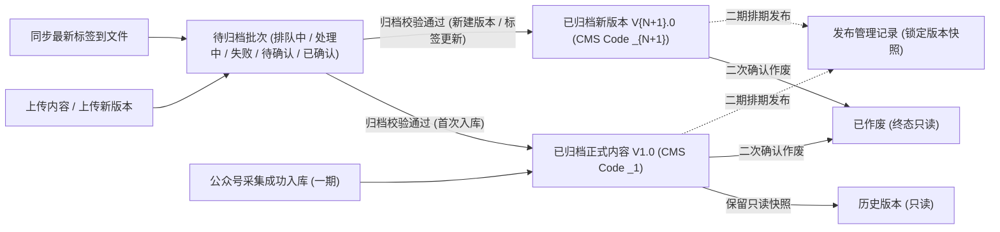
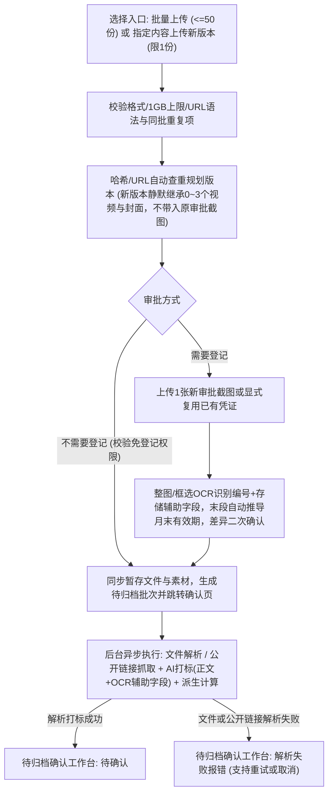
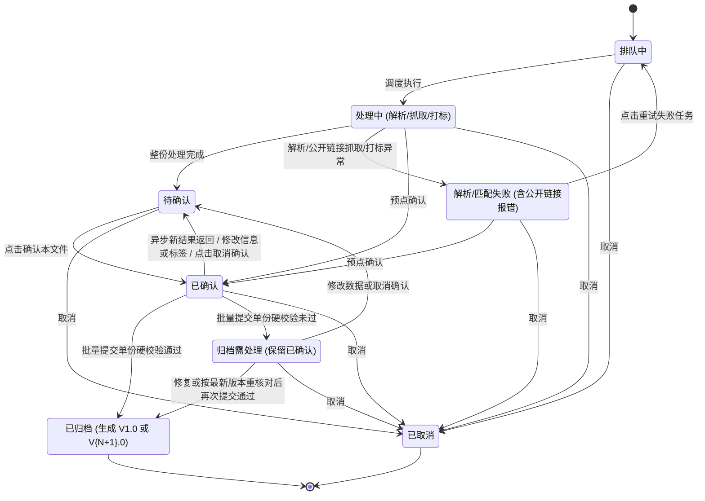
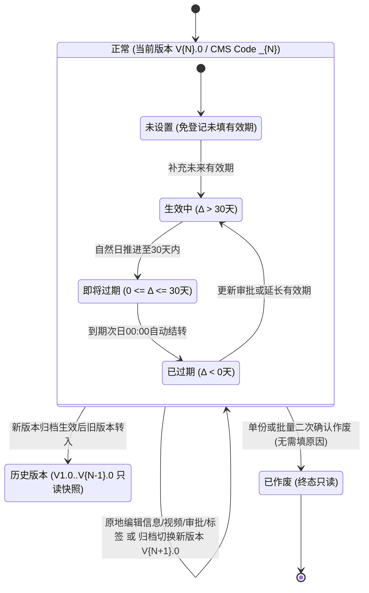
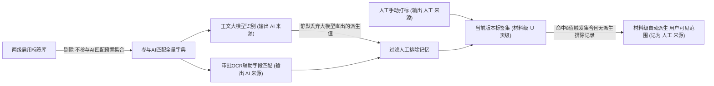
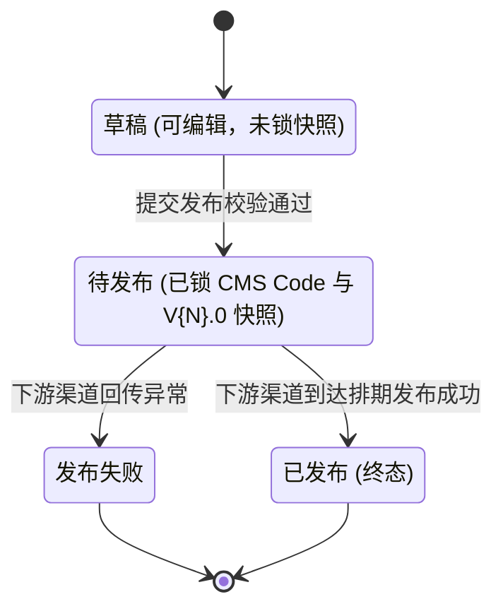

# 恒瑞内容管理系统（CMS）产品需求说明文档

---

## 一、全局规范与跨模块协同规则

### 1.1 系统定位与核心业务概念

本系统面向医药学术与专业内容运营场景：
- **一期范围**：登录认证与通知（模块一）、工作台（模块二）、内容异步上传暂存（模块三）、待归档确认工作台（模块四）、正式内容库与导出（模块五）、两级智能标签管理与批量同步（模块六）、公众号采集（模块八）、系统管理（模块九）、操作审计（模块十）。
- **二期范围**：仅模块七`发布管理`整章，以及工作台`发布失败`卡片与`近期发布`侧栏、内容库列表与详情页全部`发布`相关列与按钮（一期前端隐藏）。

| 核心概念 | 业务定义与全局规则 |
| --- | --- |
| 时区与时间格式 | 全系统存储、展示、筛选、有效期判定、排期校验及导出统一采用北京时间（`UTC+8`，24 小时制）。 |
| 企微 SSO 与纯数字工号 | 企业微信单点登录（企微 SSO）为**唯一登录方式**。登录授权后从企微获取员工**纯数字`工号`**（`1~64` 位 `0-9` 数字，保留前导零如 `000023`），精确匹配系统内唯一一条`已启用 + 关联有效角色`的用户记录。 |
| CMS Code 与版本号（`V{N}.0`） | 系统仅定义 **`CMS Code`** 编码规则，不另设文件/文档编号规则： 1. **格式**：`{业务前缀}_{首次归档日期YYYYMMDD}_{递增流水号}_{版本序号N}`（示例：`Mkt_20260928_925_1`）。 2. **生成与递增**：待归档明细在归档前不分配 `CMS Code`。新内容首次归档生成 `V1.0` 与末尾 `_1` 的 `CMS Code`；后续针对该内容每次创建新版本归档生效时（含**上传新版本**、**批量上传命中新版本**、**标签更新归档**），保持前缀主体不变，版本号取历史最大版本号 `+ 1`（`V2.0`、`V3.0`…），`CMS Code` 末尾同步递增为 `_2`、`_3`…并切换为`当前版本`。 |
| 待归档与已归档状态边界 | 异步解析与打标均以**整份文件**为最小原子单位。**`排队中`、`处理中`、`解析/匹配失败`状态仅存在于`待归档`批次内的文件中**；文件唯有异步处理`完成`并通过归档硬校验后方可进入`已归档`正式内容库。**`已归档`正式内容绝不出现排队中、解析中或解析失败状态**。 |
| 两级标签与双来源 | 标签字典固定为**一级标签（标签分类）**与**二级标签（业务标签，裸名称存储）**两级。绑定位置分为**材料级**与**页级**（仅分页文档 PDF、PPT、Word 支持，页码 `1..总页数`）。**打标结果仅区分 `AI` 与 `人工` 两种来源**（正文 AI 识别与审批 OCR 辅助字段自动匹配的标签均记为 `AI`；人工手打与规则自动派生的标签均记为 `人工`，不含审批单来源维度）。 |
| 标签双预置集合与派生机制 | 标签库包含两个**按标签 ID 独立预置固化、互不推导、无配置开关**的集合（**具体预置标签值先留空，待上线前按初始化清单确定**）：① **字典写死集合**（锁定字典不可改/不可停用，绑定层放开）；② **不参与 AI 匹配集合**（排除出所有自动打标链路，仅人工可打）。同时支持整份内容命中触发标签时在材料级自动派生目标标签（本期已确定“8 值触发 → 用户可见范围”派生规则，纯标签值，不控制任何系统权限）。 |
| 审批凭证、有效期与辅助字段 | 1. **双结构审批编号**：兼容结构 A（末段 `-YYYY-MM`，如 `TG-非肿瘤-减重瑞普泊肽注射液-02893-2028-10`）与结构 B（末段 `-YYMM` 按 `20YY-MM` 解释，如 `HR-P-108051-00001-2607`），统一从右向左提取末段年月与倒数第二段 5 位流水号。 2. **有效期唯一来源**：`已登记`模式下默认取审批编号末段年月的最后一天（末段无法解析时留空必填转人工）。 3. **审批单辅助字段**：`申请日期`、`申请类型`、`申请部门`、`疾病领域`、`产品`、`滚动年度`**无需人工填写**，仅由截图 OCR 识别后存储，供有效期一致性提示与后续 `AI` 自动打标使用。 4. **有效状态**（有效期自然日减当前自然日 = `Δ` 天）：无日期为`未设置`；`Δ > 30` 为`生效中`；`0 <= Δ <= 30` 为`即将过期`；`Δ < 0` 为`已过期`。 |

---

### 1.2 全局角色、权限与数据范围控制

- **授权总则**：内置唯一保留角色`超级管理员`（绑定保留超管账号，拥有全量权限，禁止修改/停用/删除/分配给他人）；其余为`自建角色`。写操作须同时满足：`账号已启用 + 开启所属模块菜单 + 开启对应操作权限`（仅开菜单为只读；关菜单自动清空该模块操作权限；勾选操作自动开启菜单；`系统管理`菜单与`用户与角色管理`同开同关）。`用户可见范围`等业务标签不参与任何权限控制。

| 所属菜单模块 | 权限项名称 | 适用角色 | 可执行操作 | 数据范围 | 状态限制 |
| --- | --- | --- | --- | --- | --- |
| 工作台 | 菜单访问 | 开启`工作台`菜单的角色 | 查看待确认横幅、内容异常分类卡片与待处理列表；二期开启`发布管理`菜单时可见发布概览 | 待确认横幅仅统计可见暂存批次（本人发起，超管含全部）；正式内容随`内容库`菜单可见 | 仅统计`正常`正式内容`当前版本`及未结束暂存批次 |
| 内容库 | 菜单访问 | 开启`内容库`菜单的角色 | 查看已归档列表、详情、在线预览正文与补充视频、版本历史、基础与审批文字信息 | 已归档正式内容全量可见；待归档批次仅发起人本人及超管可见 | 审批原图须额外具备`查看与下载审批截图`权限 |
| 内容库 | 上传内容 | 超管、授权角色 | 批量上传文件/公开链接、指定内容上传新版本；处理“上传归档”批次（编辑信息素材、确认/取消确认、归档、重跑失败解析、取消归档） | 全量`正常`正式内容可上传新版本；暂存批次仅限本人发起（超管含全部） | 仅`正常`正式内容可上传新版本；暂存明细`处理中`禁改信息与归档（可预点确认），终态只读 |
| 内容库 | 编辑内容与审批 | 超管、授权角色 | 修改正式内容信息与补充视频；单份或批量设置/修改正式内容审批信息 | 全量可见正式内容 | 仅`正常`正式内容`当前版本`可执行；历史版本与`已作废`只读 |
| 内容库 | 维护内容标签 | 超管、授权角色 | 增删正式内容材料级/页级标签；采纳已入库启用推荐标签；取消/恢复推荐标签 | 全量可见正式内容 | 仅`正常`正式内容`当前版本`可执行；仅限新增已启用标签；手动添加派生标签仅限材料级 |
| 内容库 | 作废内容 | 超管、授权角色 | 单份或批量作废正式内容（二次确认生效，无需填原因） | 全量可见正式内容 | 仅`正常`正式内容可执行；作废后不可恢复 |
| 内容库 | 下载与导出 | 超管、授权角色 | 下载正式内容原文件；生成结构化导出包；查看并下载导出记录；导出标签库 Excel | 全量可见正式内容与标签库；导出记录仅展示包内内容全可见的任务 | 待归档文件禁下载原文件；含审批截图导出包须同时具备`查看与下载审批截图`权限 |
| 内容库 | 免登记审批 | 超管、授权角色 | 上传内容或编辑正式内容审批时选择`不需要登记` | 本次上传批次或所选正式内容当前版本 | 上传批次归档提交时操作人仍须保有本权限 |
| 内容库 | 查看与下载审批截图 | 超管、授权角色 | 查看审批原图、复用列表缩略图；导出勾选并下载含审批截图的资产包 | 全量可见正式内容及审批凭证（当次本人新传截图允许即时预览与框选 OCR） | 无权限时显示锁定占位并禁用“包含审批截图” |
| 公众号采集 | 菜单访问 | 开启`公众号采集`菜单的角色 | 筛选检索已采集文章、预览初始采集正文、复制原始链接、跳转关联正式内容（有`编辑内容与审批`权限可补充审批） | 采集成功、正文非空且关联正式内容可见的预设公众号文章 | 采集预览固定只读；仅关联内容审批为`待补充`时展示补充审批入口 |
| 标签管理 | 菜单访问 / 维护标签库与推荐 | 开启`标签管理`菜单 / 授权角色 | 查看标签库与推荐；维护**可编辑**标签、导入导出标签、新建推荐标签、批量取消待处理推荐；同时具备`维护内容标签`时可发起并提交“同步最新标签到文件” | 全量标签库与推荐；“标签更新”批次仅发起人及超管可见 | **写死集合标签锁定字典禁改/禁停用**；全局同时限 `1` 批未结束“标签更新”批次 |
| 系统管理 | 用户与角色管理 | 超管、授权角色 | 创建/编辑/启停用户（维护纯数字工号）；模板下载、批量导入与导出用户；创建/编辑/删除自建角色 | 全系统用户与角色 | 超管账号与角色禁改/禁停/禁删；禁停用自身或撤销自身系统管理权限；有关联账号的角色禁删 |
| 操作审计 | 查看操作审计 | 超管、授权角色 | 按日期、操作人/工号、模块、操作、关键词只读检索人工写入日志 | 全系统人工写入日志 | 严格只读，不提供修改、删除或导出 |
| 发布管理（二期功能） | 菜单访问 / 创建与提交发布 | 开启菜单 / 授权角色 | 一期隐藏；二期查看发布记录与预览，新建/保存草稿/提交发布 | 可见正式内容关联的发布记录 | 仅`草稿`可编辑；仅合规且有效期非空未过期的`正常`当前版本可提交发布 |

---

### 1.3 模块间依赖、数据联动与并发冲突规则

| 触发源动作 | 跨模块联动规则 | 并发冲突与闭环处理 |
| --- | --- | --- |
| 提交上传批次 / 发起标签同步 | 立即生成`待归档`批次（`上传归档`或`标签更新`），后台异步执行整文件解析/匹配与打标，完成后推送站内通知并更新工作台横幅；**未提交归档前不影响正式内容库任何数据**。 | 防重锁拦截重复提交；上传新版本提交瞬间若目标内容版本已变或已作废，阻断批次创建并提示重选；标签同步已存在未结束批次时阻断新建并引导跳转原批次。 |
| 待归档确认提交（创建正式版本） | `上传归档`与`标签更新`针对已有内容生效时**均创建新正式版本** `V{N+1}.0` 与对应 `CMS Code`（`_{N+1}`）并切换为当前版本，旧版保留独立快照；公众号采集预览仍保持首次采集快照不变。 | 1. 按份校验目标正式内容`生命周期 = 正常`且`当前版本号 = 批次基准版本号`：若已被并发更新至更高版本，仅阻断该份并标记`归档需处理`（提供按最新版本重核对/重同步），同批其余合格项正常归档；若目标已作废则提示取消该明细。 2. 二期发布管理：已提交发布记录保持原锁定快照不变并提示有新版本；草稿提示同步最新版本。 |
| 正式内容修改信息 / 审批 / 标签 / 作废 | 修改即时作用于当前版本（触发标签变动实时重算材料级派生标签）；作废后移出正常列表、工作台待办、可同步标签范围及二期可发布范围。 | 作废内容若仍存在于未结束的待归档批次中，归档校验拦截该份并提示取消本明细。 |
| 可编辑标签改名 / 换分类 / 停用 | 改名或换分类前保存旧名快照，存量绑定按标签 ID 即时显示新名称/新分类；停用后存量绑定标注`已停用`，选择器与自动匹配立即排除；修改`对外展示`即时生效。 | 待归档明细若当次新增绑定了随后被停用的标签，归档提交时单份拦截并提示移除或替换该停用标签。 |
| 账号停用 / 角色权限变更 | 保存后实时生效，保留名下正式内容归属、历史批次与审计快照。 | 在途会话于下次路由切换或写提交时重验：账号停用则强制下线至登录页；权限收回则拦截提交并刷新界面可用态，保留未提交输入。 |

---

## 二、功能模块需求说明

### 模块一：登录认证与全局通知框架

#### 1.1 功能目标
通过企微 SSO 唯一通道获取纯数字工号完成身份认证与权限加载，提供全局导航、未保存离开保护及站内消息通知中心。

#### 1.2 适用场景
员工通过企业微信单点登录系统、跨模块切换、接收异步任务与核对预警通知、退出登录。

#### 1.3 业务规则

##### （1）企微 SSO 登录与纯数字工号匹配规则
1. 系统仅开放**企业微信单点登录（企微 SSO）**，不设账号密码登录页。
2. 企微授权回调成功后提取员工**纯数字`工号`**（去除首尾空格后校验为 `1~64` 位 `0-9` 数字，保留前导零），在用户库精确匹配唯一一条`已启用 + 关联有效角色`的用户记录。
3. 登录成功后优先进入`工作台`（无工作台权限则进入首个已授权菜单）；上传页存在未提交内容时离开触发二次确认，媒体/原文件正在上传落盘时阻断路由切换并提示稍候。

##### （2）全局导航与消息通知规则
1. **侧边导航**：一期按授权展示`工作台`、`内容库`（常驻徽标显示正式内容总数）、`公众号采集`、`标签管理`、`系统管理`、`操作审计`；`发布管理`在一期隐藏。
2. **未读合并与推送事件**：同一接收人下同`标题`、同`跳转路由`且`未读`的通知自动覆盖合并说明与时间。仅下列事件推送站内通知（单文件确认/取消确认、派生计算、素材继承、审批字段映射未命中、普通表单同步保存均不推送）：

| 事件名称 | 触发条件 | 接收人 | 通知标题与说明要点 | 写入审计 | 点击跳转路由 |
| --- | --- | --- | --- | --- | --- |
| 上传批次解析完成 | 上传批次活跃明细全部完成异步解析打标且无失败 | 发起人 + 超管 | `解析打标完成，待确认归档`：`{N} 份内容已完成解析打标，请核对后归档。` | 否 | 该上传批次确认页 |
| 上传批次含解析失败 | 上传批次异步处理结束且存在解析失败明细（含公开链接抓取失败） | 发起人 + 超管 | `上传批次存在解析失败`：`成功 {S} 份，失败 {F} 份，请查看原因并重试或取消。` | 否 | 该上传批次确认页 |
| 标签同步匹配结果 | “同步最新标签到文件”批次后台匹配结束（全部成功或含失败） | 发起人 + 超管 | `标签匹配完成，待确认结果`（含失败时注明成功/失败份数） | 发起时记 | 该标签更新批次确认页 |
| 批次归档提交完成 | 上传归档或标签更新批次点击归档提交，至少 `1` 份成功生成正式版本 | 发起人 + 超管 | `内容归档完成` / `标签更新归档完成`：单份附新生成 `CMS Code`；多份汇总成功/需处理份数 | 是 | 对应批次确认页 |
| 审批 OCR 差异预警 | 上传或编辑审批时存在 OCR 差异/未识别且人工确认保存 | 有`用户与角色管理`权限者 | `审批信息存在 OCR 差异已人工核对`：附审批编号及关联 `CMS Code` 或份数 | 随原动作记 | 关联详情审批抽屉或批次 |
| 资产导出包结果 | 结构化导出包异步打包完成或失败 | 导出发起人 | `内容资产导出包已生成` 或 `内容资产导出失败` | 否 | 内容库并打开`导出记录` |

##### （3）字段规则

| 字段名称 | 含义 | 必填性 | 取值范围或格式 | 默认值 | 来源 | 联动关系 | 校验提示 |
| --- | --- | --- | --- | --- | --- | --- | --- |
| 企微 SSO 凭证 | 企微单点登录回调票据 | 系统必填 | 企微标准授权码 | 无 | 企微回调 | 解析换取员工纯数字`工号` | 见 1.6 异常提示 |
| 工号（登录匹配键） | 员工唯一数字标识 | 系统必填 | `1~64` 位纯数字（`0-9`，保留前导零） | 无 | 企微 SSO 获取 | 精确匹配唯一启用账号与角色 | 见 1.6 异常提示 |
| 通知标题 / 说明 / 时间 | 站内通知展示项 | 系统必填 | 文本 / 北京时间 `MM-DD HH:mm` | 当前时间 | 系统事件生成 | 未读同标题同路由合并；按时间倒序 | 无 |

#### 1.4 整体流程
1. 访问系统 → 拉起企微 SSO 授权 → 服务端获取纯数字`工号`并校验启用状态与角色权限 → 建立会话进入默认授权页。
2. 点击右上角铃铛查看未读通知（点击单条标为`已读`并跳转，支持`全部标为已读`）；点击个人菜单`退出账号`销毁会话返回企微登录引导页。

#### 1.5 关键状态
- **会话状态**：`未登录`、`已登录`、`强制下线`。
- **通知状态**：`未读`、`已读`。

#### 1.6 结果反馈
- 登录拦截就地提示（不记审计）：① 票据过期提示“企业微信登录凭证已过期或无效，请重新发起登录”；② 未获取纯数字工号或未建号提示“未匹配到关联该工号的系统账号，请联系管理员核对工号”；③ 账号停用提示“当前工号对应账号已停用”；④ 无有效角色或无菜单提示“当前账号未配置菜单权限，请联系管理员”；⑤ 重复异常数据阻断登录并提示联系管理员。

---

### 模块二：工作台

#### 2.1 功能目标
按优先级聚合当前用户可见的`待归档`批次进度与`已归档`正式内容的合规/到期/推荐标签待办（二期含发布概览），支持一键直达处理。

#### 2.2 适用场景
日常巡检待确认归档文件、排查待归档解析异常、跟进已归档内容的过期/待补审批/待核对推荐标签事项。

#### 2.3 业务规则

##### （1）区块统计与优先级规则
1. **顶部快捷上传**：同时具备`内容库`菜单与`上传内容`权限时展示“上传内容”按钮。
2. **待确认结果横幅**（统计可见未结束`待归档`批次明细，对具备`上传内容`或`维护标签库与推荐 + 维护内容标签`者展示）：
   - `待确认结果 {N} 份`：异步状态为`完成`且未归档、未取消的份数；
   - `另有 {M} 份处理中 · {K} 份异常需处理`：`M` 为`排队中/处理中`份数，`K` 为`解析/匹配失败`或`归档需处理`份数。
3. **正式内容待处理列表**（仅统计可见且`生命周期 = 正常`的`已归档`正式内容`当前版本`，每页 `6` 条；已归档内容无解析中或解析失败状态）：
   - 同一内容命中多项时合并一行展示徽标，按行内最高优先级升序、同级按`最近更新时间`倒序排列：

| 问题徽标 | 归属分类卡片 | 判定条件 | 优先级 | 颜色 | “去处理”跳转目标 |
| --- | --- | --- | --- | --- | --- |
| 已过期 | `30 天内到期或已过期` | 当前版本有效状态为`已过期` | `0` | 红色 | 内容详情页并展开“审批信息”抽屉 |
| 审批信息待补充 | `审批待补充` | 当前版本审批状态为`待补充`（如公众号采集入库内容） | `1` | 蓝色 | 内容详情页并展开“审批信息”抽屉 |
| 标签待核对 | `标签待核对` | 当前版本存在未处理的推荐标签 | `2` | 蓝色 | 内容详情页 |
| 即将过期 | `30 天内到期或已过期` | 当前版本有效状态为`即将过期` | `3` | 琥珀色 | 内容详情页并展开“审批信息”抽屉 |

4. **发布概览区块（二期功能）**：一期隐藏（单栏布局）；二期对开启`发布管理`菜单者展示`发布失败`卡片与右侧最近 `4` 条`待发布`排期侧栏。

##### （2）字段规则

| 字段名称 | 含义 | 必填性 | 取值范围或格式 | 默认值 | 来源 | 联动关系 | 校验提示 |
| --- | --- | --- | --- | --- | --- | --- | --- |
| 分类卡片计数 | 各异常分类正式内容份数 | 系统必填 | 非负整数 | `0` | 按份去重实时聚合 | 点击卡片过滤列表，再次点击复位`全部` | 无 |
| 待处理内容行 | 异常正式内容摘要 | 系统必填 | 文件类型、标题、`CMS Code`、`V{N}.0`、问题徽标组 | 无 | 正式内容当前版本 | 点击“去处理”按最高优先级（筛选态按所选分类）跳转 | 无 |
| 近期发布项（二期） | 临近排期摘要 | 系统必填 | 拟发布时间、发布标题、`V{N}.0`、状态 | 无 | 发布管理记录 | 点击跳转发布管理对应记录抽屉 | 无 |

#### 2.4 整体流程
1. 进入工作台加载待确认横幅与正式内容异常卡片计数 → 点击“处理待确认结果”进入`内容库 - 待归档`，或点击分类卡片筛选待办行并点击“去处理”进入目标详情修复。

#### 2.5 关键状态
- **问题分类筛选态**：`全部`（默认）、`审批待补充`、`标签待核对`、`30 天内到期或已过期`。

#### 2.6 结果反馈
- 待办事项归档、修复或内容作废后返回工作台，计数与列表行实时扣减；无待办时展示空态引导。

---

### 模块三：内容上传与暂存登记

#### 3.1 功能目标
支持最大 `1 GB` 多格式本地文件与公开链接的批量上传或单目标新版本上传，执行去重与跨版本素材自动继承、双结构审批编号与月末有效期解析、截图框选 OCR 核对，异步提交待归档解析打标任务。

#### 3.2 适用场景
批量新增内容或自动匹配创建新版本、针对指定正式内容上传新版本、上传阶段登记合规审批截图。

#### 3.3 业务规则

##### （1）两种上传入口的数量限制与同批去重规则
1. **批量上传模式（“上传内容”入口）**：
   - 支持本地文件与公开链接混合添加，单批次上限 `50` 份。
   - **同批重复文件/链接限传 1 份**：同一批次内哈希值完全相同的文件或规范化后相同的公开链接**仅允许上传 `1` 份**；存在重复项时标记`需处理`并阻断提交，提示：**“同一批次内重复文件或相同公开链接仅允许上传 1 份，请移除重复项”**。
   - **自动查重规划版本**：按文件哈希相等或公开链接相等在`正常`正式内容及其历史版本中匹配——命中已有内容时自动规划为该内容的`创建新版本`（预计 `V{N+1}.0`，行内展示命中内容的 `CMS Code` 与标题；因同批禁止重复文件/链接，同一目标内容在单批次内最多仅会规划 `1` 个新版本）；未命中则规划为`新增内容`（预计 `V1.0`）。
2. **指定内容“上传新版本”模式（从正式内容发起）**：
   - 目标正式内容须为`正常`，锁定打开页面时的基准版本号。
   - **单目标新版本限传 1 份**：针对单个指定内容上传新版本时，**一次仅允许上传 `1` 个本地文件或录入 `1` 条公开链接**（再次选择单个文件时替换当前待传项；一次拖入/选择多个文件或粘贴多行链接时拦截并提示：**“针对单个内容上传新版本时，一次仅允许上传 1 个文件或 1 条公开链接”**）。

##### （2）文件规格、公开链接异步抓取与跨版本继承规则
1. **文件格式与容量**：支持 `PDF`（`.pdf`）、`PPT`（`.ppt/.pptx`）、`Word`（`.doc/.docx`）、`网页`（`.html/.htm`）、`图片`（`.png/.jpg/.jpeg/.webp/.gif`）、`视频`（`.mp4/.mov/.webm`）；单文件须 `> 0 B` 且 **`<= 1 GB`**。
2. **公开链接两段式校验**：上传页仅同步校验 URL 格式（`http://` 或 `https://` 开头且不含账号密码）与同批去重；**网页抓取与正文提取归入提交后的后台异步解析步骤**，抓取失败或无有效正文统一在模块四解析结果页（待归档确认工作台）报错。
3. **初始空摘要与跨版本素材自动继承**：
   - 所有新上传本地文件（含 HTML）与公开链接的初始`摘要`均默认**为空**，不截取正文预填。
   - 凡属创建新版本（含指定上传新版本及批量上传命中新版本），提交暂存时**静默自动继承目标内容上一版本的全部补充视频（`0~3` 个，保持原顺序）及未单独重设的封面与缩略图**（无弹窗提示，可在待归档确认前独立增删改排，不影响历史版本快照）。
   - **新版本不带入原审批截图**：创建新版本时**不带入原版本的审批截图，亦不默认预填原审批编号与有效期**；选`需要登记`时须上传新审批截图，或主动点击“使用已有审批信息”显式复用历史凭证。

##### （3）审批编号双结构解析、有效期推导、框选 OCR 与辅助字段后台存储规则
1. **整批共用审批方式**：`需要登记`（默认，必填审批编号、有效期与 `1` 张截图）或`不需要登记`（需`免登记审批`权限）。
2. **双结构审批编号与唯一自动有效期**：
   - 经 `NFKC` 规范化后**从右向左**解析末段年月与倒数第二段 `5` 位流水号：兼容结构 A 末段 `-YYYY-MM`（如 `TG-非肿瘤-减重瑞普泊肽注射液-02893-2028-10`）与结构 B 末段 `-YYMM`（如 `HR-P-108051-00001-2607` → `2026-07`），不限制首段枚举，不按左起连字符切分疾病或产品。
   - **审批有效期唯一自动来源**：自动填入编号末段年月的自然月最后一天（如 `2028-02` → `2028-02-29`）；末段无法解析合法年月时有效期留空并转为人工必填。
3. **截图框选 OCR 与差异核对**：
   - 上传 `1` 张审批截图后默认整图 OCR，并支持用户在截图预览画布上**拖拽框选局部区域重新识别**。
   - 填写值与 OCR 识别值不一致或无法识别时，提交触发“确认审批识别差异”二次确认弹窗，确认后按人工填写值落库并保留原始识别值。
4. **审批单辅助字段（无需人工填写，仅后台存储与支持打标）**：
   - `申请日期`、`申请类型`、`申请部门`、`疾病领域`、`产品`、`滚动年度`在界面上**无需用户填写**，仅由 OCR 识别提取后随审批凭证存储。
   - **辅助核对**：当 OCR 识别出`申请日期`与`申请类型`（推广类材料：`申请日期`年份 `+2` 年当月月末；非推广类材料：年份 `+3` 年当月月末）或`滚动年度`，且与编号末段有效期不一致时，展示非阻断轻量核对提示（不覆盖末段推导值）。
   - **支持后续 AI 打标**：异步解析打标阶段，系统读取存储的 OCR 字段`申请部门`、`疾病领域`、`产品`（经规范化、复合值拆段、剥离常见剂型后缀及标准词典历史别名回退），跨分类匹配**参与 AI 匹配且启用**的二级标签，命中项写入材料级且来源统一记为 **`AI`**；未命中或停用/排除项静默跳过。

##### （4）字段规则

| 字段名称 | 含义 | 必填性 | 取值范围或格式 | 默认值 | 来源 | 联动关系 | 校验提示 |
| --- | --- | --- | --- | --- | --- | --- | --- |
| 上传内容文件 | 本地原始业务文件 | 文件模式必填 | 支持文档/网页/图片/视频，`> 0 B` 且 `<= 1 GB`；批量限 50 份且同批禁重，单目标新版本限 1 个 | 空 | 本地选择或拖拽 | 提取去后缀文件名作默认标题，计算哈希查重 | 超限：“单个文件大小不能超过 1 GB”；同批重复：“同一批次内重复文件或相同公开链接仅允许上传 1 份，请移除重复项”；单目标多选：“针对单个内容上传新版本时，一次仅允许上传 1 个文件或 1 条公开链接” |
| 公开链接 | 外部网页地址 | 链接模式必填 | 不含账号密码的 `http://` 或 `https://` URL；同批禁重，单目标新版本限 1 条 | 空 | 用户输入 | 提交后异步抓取解析正文，失败在待归档确认页报错 | 格式错误：“请填写不含账号密码的 HTTP / HTTPS 公开链接”；重复或多条同上 |
| 内容标题 | 业务标题 | 必填 | 去首尾空格非空文本 | 文件名或`公开链接内容` | 默认带入可改 | 为空阻断提交 | “请输入内容标题” |
| 摘要 | 内容简介 | 选填 | 多行文本 | **空** | “补充信息”弹窗输入 | 带入详情及二期发布默认摘要 | 无 |
| 封面 / 缩略图 | 头图 / 列表图 | 选填 | 有效图片（`<= 10 MB`）或预设图 | 新版本未重设时静默继承上一版；新增为空 | 上传、选预设图或清除 | 独立保存 | “请选择不超过 10 MB 的有效图片” |
| 补充视频 | 配套独立视频列表 | 选填 | `0~3` 个非空 `.mp4/.webm/.mov`（单个 `<= 1 GB`），可预览/替换/删除/排序 | **新版本静默继承上一版全部视频与顺序**；新增为空 | “补充信息”维护或继承 | 满 3 个禁用上传；行内回显 `K/3` | “请选择非空的 MP4/WebM/MOV 视频（不超过 1 GB）” / “最多上传 3 个补充视频” |
| 审批方式 | 合规登记策略 | 必选 | `需要登记`、`不需要登记` | `需要登记` | 用户单选 | 无`免登记审批`权限禁用`不需要登记` | “当前角色无免登记审批权限” |
| 审批编号 | 审批单号 | `需要登记`必填 | `NFKC` 归一后 `8~64` 字符，禁含空格/`/`/全角括号；兼容末段 `-YYYY-MM` 与 `-YYMM` | **空**（新版本不预填，显式选复用除外） | OCR、框选识别、显式复用或手填 | 从右向左推导末段月末填入`审批有效期` | “请填写 8~64 位有效审批编号” |
| 审批有效期 | 合规截止日 | `需要登记`必填 | 有效日期 `YYYY-MM-DD` | 自动取编号末段月末；末段异常为空 | 末段自动推导或手填 | 与 OCR 申请日期推算值不一致时展示非阻断提示 | “请填写有效的审批有效期” |
| 审批截图 | 审批图像凭证 | `需要登记`必填 | 有效图片（`<= 20 MB`），限 `1` 张 | **空**（**新版本不带入原截图**，显式复用除外） | 本地上传或显式复用 | 触发整图/框选 OCR 并提取后台辅助字段 | “请上传一张审批截图（不超过 20 MB）” |
| 审批单辅助字段 | 申请日期/类型/部门/疾病领域/产品/滚动年度 | **无需填写** | 系统后台存储元数据 | OCR 识别结果 | 审批截图 OCR 提取 | 界面无输入框；供有效期核对及异步 `AI` 打标 | 无 |

#### 3.4 整体流程

#### 3.5 关键状态
- **上传页同步状态**：`待提交`、`需处理`（格式/容量/同批重复/必填阻断）、`已暂存`。
- **异步进入待归档状态**：`排队中`、`处理中`、`待确认`、`解析失败`（具体流转见模块四状态机）。

#### 3.6 结果反馈
- 暂存成功 Toast 提示后台正在解析打标并跳转待归档确认页，记`提交上传批次`审计；异步结束后推送完成或含失败站内通知（公开链接不可达或无有效正文在待归档确认页明细区直接报错）。

---

### 模块四：待归档管理与结果确认

#### 4.1 功能目标
以统一确认工作台承接`上传归档`与`标签更新`两类异步批次，展示异步解析/抓取报错并支持整份重试，提供单文件无前置硬校验确认、批量提交按份硬校验创建正式版本及取消机制。

#### 4.2 适用场景
上传批次异步处理期间或完成后核对信息、素材与标签并分批归档；标签同步批次核对标签并提交创建新版本；对公开链接抓取失败或解析失败项重试或取消。

#### 4.3 业务规则

##### （1）两类批次统一准则与仅有的必要差异
1. **本质统一**：`上传归档`与`标签更新`共享同一套队列筛选、无前置硬校验单文件确认、确认自动失效、标签核对面板、取消机制及归档提交按份硬校验逻辑。**针对已有正式内容提交生效时，两类批次本质完全相同——均是创建新正式版本 `V{N+1}.0` 与递增后缀的 `CMS Code`（`_{N+1}`）并切换为当前版本**（`上传归档`中首次入库内容则创建 `V1.0` 与 `_1`）。
2. **两类批次仅在以下必要处区分**：

| 区分维度 | 上传归档批次 | 标签更新批次 |
| --- | --- | --- |
| 发起入口与操作权限 | 由`内容库 - 上传内容`发起；需`上传内容`权限 | 由`标签管理 - 同步最新标签到文件`发起；需`维护标签库与推荐 + 维护内容标签`权限（全局限 1 批未结束） |
| 确认工作台默认展示页签 | `内容信息与素材` | `打标结果` |
| 元数据与素材维护范围 | 异步解析完成后可编辑标题、摘要、封面、缩略图及 `0~3` 个补充视频；源文件与上传登记的审批信息只读 | 完整继承基准版本的源文件、标题、摘要、封面、缩略图、`0~3` 个补充视频及审批快照，上述项**全部只读**，仅维护两级标签与推荐标签 |

##### （2）单文件无前置硬校验确认与确认失效规则
1. **单文件确认无前置硬校验**：未处于`已归档`或`已取消`终态的任意明细（含`处理中`、`待确认`、`失败`、`归档需处理`），底部`确认本文件（并查看下一份）`始终可点，无必打标签或推荐清零前置限制（零标签与预置写死标签未打均直接放行）；`已确认`可随时点击`取消确认`退回`待确认`。
2. **确认自动失效**：当① `处理中`预确认后异步返回新解析/匹配结果、② 用户修改了该明细信息/素材/视频/标签/推荐、③ 触发了失败重试或按最新版本重新核对时，该明细自动退回`待确认`（不影响同批其他文件）。

##### （3）统一归档提交按份独立硬校验与取消规则
1. **统一按份硬校验**（两类批次共用同一套归档校验，无标签更新专属冻结校验）：点击底部批量归档按钮（如`归档已确认的 N 份`）时，逐份独立校验已确认明细：
   - ① 整份文件异步解析/匹配状态必须为`完成`（`排队中/处理中`或`解析/匹配失败`不予入库）；
   - ② 内容标题非空，存储中的源文件、关联补充视频及已登记审批截图完整可读；
   - ③ 绑定标签页码在 `1..总页数` 内（材料级派生标签仅位于材料级），且当次新增绑定的标签均处于启用状态；
   - ④ 审批凭证有效（上传批次`需要登记`时编号、有效期、截图齐全且 OCR 差异已确认，`不需要登记`时仍保有免登记权限；标签更新批次直接继承原正式版本审批快照）；
   - ⑤ **新建版本并发校验**：凡属为已有正式内容创建新版本的明细（上传新版本项与标签更新全部明细），目标正式内容`生命周期`须仍为`正常`且`当前最新版本号 = 批次基准版本号`。
2. **逐份结果落库与失败重试/取消**：校验通过的明细立即生成正式版本并置为`已归档`终态；未通过项**保留`已确认`状态**并标记`归档需处理`就地提示原因，不阻塞同批合格明细生效。异步解析失败（含公开链接抓取/提取正文失败）或匹配失败的明细展示具体报错，支持点击`重试失败任务`整份重跑，或执行单份/整批剩余`取消`（二次确认后置为`已取消`终态）。

##### （4）字段规则

| 字段名称 | 含义 | 必填性 | 取值范围或格式 | 默认值 | 来源 | 联动关系 | 校验提示 |
| --- | --- | --- | --- | --- | --- | --- | --- |
| 队列状态筛选 | 过滤左侧批次明细 | 必选 | `全部文件`、`待确认`、`处理中`、`已确认`、`已取消` | `全部文件` | 用户选择 | 实时展示各状态份数 | 无匹配显示空态 |
| 标签作用范围与页码 | 切换打标核对作用域 | 必选 | 分页文档：`材料标签`、`页级标签`（`第 1..N 页`）；非分页：仅`材料标签` | `材料标签` | 用户切换 | 页码与左侧阅读器双向同步；手动加派生标签仅限材料级 | 无 |
| 标签绑定芯片 | 已绑定二级标签 | 选填（可为 0 个） | 按一级分类分组展示裸名称与来源标识（**仅 `AI` / `人工`**） | 异步打标结果 | AI 识别或人工维护 | 触发标签变动实时重算材料级派生标签；删除记排除记忆；修改退回`待确认` | 新增停用标签：“只能添加已启用的标签” |
| 人工核对备忘 | 个人巡检辅助标记 | 选填 | 布尔复选框`已人工核对标签` | 未勾选 | 用户勾选 | 不构成确认或归档校验条件 | 无 |

#### 4.4 整体流程
1. 进入待归档批次确认页 → 左侧选择文件（若公开链接或本地文件异步解析失败，查看报错并点击`重试失败任务`或`取消`）。
2. 核对`内容信息与素材`（上传批次可弹窗修改标题/摘要/封面/缩略图/`0~3`个视频）与`打标结果`（核对 `AI` / `人工` 标签与推荐标签，具备`维护标签库与推荐`权限可新建标签）。
3. 点击`确认本文件`标记确认 → 点击底部批量归档按钮按份校验入库，成功项生成正式版本（`V1.0` 或 `V{N+1}.0` 及对应 `CMS Code`）。

#### 4.5 关键状态

#### 4.6 结果反馈
- 单文件确认/取消确认仅轻提示，不发通知、不记审计；批量归档提交反馈成功/需处理份数，记`确认结果并归档`审计并推送站内通知。
- 典型异常提示：① 公开链接/文件解析失败：“公开链接无法访问或未能提取有效正文 / 文件解析未完成（{具体原因}），请点击‘重试失败任务’或取消本文件”；② 并发新版本冲突：“目标正式内容已更新至新版本，请按最新版本重新核对/重新同步后再提交”；③ 目标内容已作废：“目标正式内容已作废，请取消本明细”。

---

### 模块五：正式内容库、详情与导出管理

#### 5.1 功能目标
管理已完成解析入库的`已归档`正式内容及其多版本快照、`CMS Code`、最多 `3` 个补充视频与展示图、双层标签检索与联动维护、合规审批更新、无原因快速作废及结构化资产包导出。

#### 5.2 适用场景
按 `CMS Code`/标签/审批号检索正式内容、分页阅读与维护指定页标签、切换查阅历史版本快照、批量更新审批、作废内容或导出 `.zip` 资产包。

#### 5.3 业务规则

##### （1）已归档列表与双层标签检索规则
1. `已归档`列表展示各正式内容的`当前版本`（每页 `8` 条，默认`内容状态 = 正常`；**已归档内容均已完成解析，无排队中、解析中或解析失败状态**）。列表展示标题、`CMS Code`、版本号 `V{N}.0`、来源、材料标签、审批状态与编号、有效状态及更新时间（发布相关列与按钮属二期隐藏）。
2. **综合搜索与双层标签过滤**：
   - 搜索框忽略大小写匹配当前及历史版本 `CMS Code`（支持完整编码或前缀主体检索）、标题、审批编号、维护人姓名及纯数字工号。
   - 标签筛选：同一级分类内多选按 **`OR`**、跨一级分类按 **`AND`** 匹配；`材料标签`匹配当前版本材料级绑定（`AI` / `人工`），`页级标签`要求分页文档（PDF、PPT、Word）所选跨分类标签**同时命中同一页码**。

##### （2）版本快照、信息素材、审批与标签维护规则
1. **多版本切换与只读边界**：支持切换查看 `V1.0 .. V{current}.0` 及各自对应的 `CMS Code`（如 `_1 .. _{current}`）。仅`正常`内容的`当前版本`可编辑信息、修改审批、维护标签与处理推荐；**全部`历史版本`与`已作废`内容严格只读**（可预览对应版本的正文与 `0~3` 个补充视频、下载原文件及导出指定版本资产包）。
2. **编辑内容信息与审批**：
   - 编辑内容信息：修改当前版本标题、摘要、封面、缩略图、`0~3` 个补充视频（增删/替换/排序）及`免登记`模式选填`内容有效期`，原地保存不升版。
   - 编辑审批信息：支持列表批量或详情单份设置/更新审批（复用模块三双结构编号末段月末有效期推导、截图整图/框选 OCR 与差异确认规则；OCR 提取的辅助字段自动补充匹配新命中的 `AI` 材料级标签，既有绑定保留），原地更新当前版本审批快照。
3. **详情阅读器与标签面板**：分页文档提供左缩略图、中画布（缩放/跳页/文内检索/全屏）、右页级标签双向联动；标签芯片仅展示裸名称与 **`AI` / `人工`** 来源标识，增删触发标签实时重算材料级派生标签，删除任意标签写入对应位置排除记忆。

##### （3）作废与结构化资产包导出规则
1. **作废内容（无需填写作废原因）**：支持列表批量勾选或详情单份点击`作废`，弹出二次确认弹窗（提示份数及“作废后不可恢复”），确认后内容生命周期立即变更为`已作废`终态。
2. **原文件下载与结构化导出包（`.zip`）**：
   - 公开链接网页无原始实体文件时点击下载提示无原文件，导出包内生成 `content.html`。
   - 导出包结构：根目录 `manifest.json` + 每份内容按 **`{CMS_Code}/`** 建目录，内含 `original/`、`metadata.json`（含 `cmsCode`、`version`、标题、摘要、来源、有效期、审批信息、`videos` 有序数组、`tags` 数组［`origin` 枚举严格为 **`AI | 人工`**］）、`media/`（封面、缩略图及 `media/video/1..3-{文件名}`）、`approval/`（勾选包含审批截图且具权限时写入）。历史导出记录二次下载实时重验内容可见性与审批截图权限。

##### （4）字段规则

| 字段名称 | 含义 | 必填性 | 取值范围或格式 | 默认值 | 来源 | 联动关系 | 校验提示 |
| --- | --- | --- | --- | --- | --- | --- | --- |
| 搜索框 | 综合检索词 | 选填 | 文本 | 空 | 用户输入 | 匹配 `CMS Code`、标题、审批号、维护人姓名/工号 | 无匹配展示空态 |
| 列表筛选组 | 多维组合过滤 | 选填 | 内容类型、有效状态、材料标签、页级标签、来源、审批登记、推荐标签（`全部/有待处理推荐`）、内容状态（`正常/已作废/全部`） | 内容状态默认`正常`，其余`全部` | 用户选择 | 变更重置第 1 页并清空勾选 | 无 |
| 内容有效期 | 免登记自定义到期日 | 选填 | 日期 `YYYY-MM-DD` | 原值或空 | 仅`免登记`内容在编辑弹窗展示 | 为空时有效状态为`未设置`（二期不可发布） | 无 |
| 包含审批截图 | 导出包附带审批原图 | 选填 | 布尔复选框 | 未勾选 | 导出弹窗勾选 | 无`查看与下载审批截图`权限禁用勾选与二次下载 | “当前无审批截图权限，请重新导出不含截图资产包” |

#### 5.4 整体流程
1. 在`内容库 - 已归档`按 `CMS Code` 或双层标签检索 → 批量设置审批、批量导出或二次确认作废，或进入详情切换查阅版本、在线阅读维护标签、编辑信息与补充视频、导出 `.zip` 包。

#### 5.5 关键状态

#### 5.6 结果反馈
- 编辑信息、更新审批、维护标签及作废即时 Toast 反馈并记`内容库`审计；下载与导出不记审计（打包失败在导出记录展示原因并支持重新导出）。

---

### 模块六：标签管理与批量标签同步

#### 6.1 功能目标
维护平台两级业务标签字典，落地“字典写死集合”与“不参与 AI 匹配集合”两项正交通用管控能力及材料级标签自动派生机制（含已确定的“用户可见范围”派生规则），支持全入口重名/相似校验、推荐标签按源治理及创建新版本式的批量标签同步。

#### 6.2 适用场景
管理一二级标签与 Excel 导入导出、审核推荐标签、更新标签库后对存量正式内容批量同步补充标签并归档生成新版本。

#### 6.3 业务规则

##### （1）两级标签架构与两个独立系统预置集合通用规则
1. **两级裸名称结构**：严格固定为**一级标签（标签分类）**与**二级标签（业务标签，裸名称存储，不含分类前缀）**两级，禁止新建第三级或变更层级（兼容标准智能标签体系二级分类维度）。
2. **两个正交独立的系统预置集合**（均按**标签 ID** 系统预置固化，**两集合互不推导、不由一级分类推导、界面与 Excel 均不开放编辑开关**；**两个集合的具体预置标签值当前先留空，待上线前按初始化清单配置**）：

| 预置集合名称 | 集合划分与通用管控规则 |
| --- | --- |
| 预置集合一：字典写死集合（具体标签值留空待定） | 1. **写死集合**：卡片展示只读`系统预置`标识；**字典层完全锁定**（禁止改名、换一级分类、停用、调序或删除；Excel 导出正常包含，Excel 导入凡命中该集合标签的改名/换分类/停用或同分类重名新增均判为`错误`行阻断导入）；**绑定层完全放开**（不设必填或互斥，支持多选打在材料级或页级、支持手动移除并记入排除记忆）。 2. **可编辑集合**：写死集合外的全部标签（含新建标签默认归属），授权用户可正常改名、换分类、启停及切换对外展示：改名/换分类前留存旧名快照并按 ID 即时更新存量展示；停用后存量绑定保留并标`已停用`。 |
| 预置集合二：不参与 AI 匹配集合（具体标签值留空待定） | 1. **不参与 AI 匹配集合**：卡片展示只读`仅人工标注`标识；在全系统所有自动打标链路（上传异步 AI 打标、批量同步最新标签、审批 OCR 辅助字段匹配、AI 推荐标签生成）中统一排除，**仅允许人工在标签选择器手动添加**。 2. **参与 AI 匹配集合**：等于全量已启用且所属分类已启用的二级标签减去“不参与 AI 匹配集合”（新建普通标签默认归入本集合），全量进入大模型打标字典。 |

##### （2）标签自动派生通用机制与“用户可见范围”确定派生规则
1. **材料级自动派生通用机制**：
   - **整份并集触发、不限来源**：系统监控整份内容当前版本`材料级 ∪ 全部页级`已绑定标签并集；无论触发标签来源为 **`AI`** 还是 **`人工`**，命中预设触发集合时实时在**材料级**自动补充对应派生目标标签（不落页级、不重复绑定，多组同时命中则同时保留）。
   - **拦截大模型直出**：派生目标标签若由大模型直接输出，在落库前静默丢弃，确保派生结果仅由派生规则或人工显式手打产生（自身不循环触发）。
   - **来源归属与排除记忆**：自动派生的标签来源统一记为 **`人工`**；人工手动添加派生标签仅在`材料标签`开放；人工在材料级手动移除某派生标签后写入材料级人工排除记忆，此后无论触发标签如何变动或重跑同步均不再自动补回（直至人工在材料级重新添加该标签才解除排除）。
2. **本期已确定的派生规则（用户可见范围派生）**：
   - 固化映射如下（“三类用户”指`未注册 / 已注册待认证 / 已认证`，仅作标签命名依据，不控制任何系统权限）：

| 触发标签集合（整份内容材料级 ∪ 全部页级命中任一即触发） | 自动派生的材料级标签（用户可见范围） |
| --- | --- |
| `指南共识`、`临床研究`、`综述与前沿`、`疾病知识与患教` | `All三类用户` |
| `治疗方案`、`病例分享`、`产品准入`、`用药安全` | `已注册待认证、已认证` |

##### （3）名称查重相似检查、Excel 导入导出与推荐治理规则
1. **重名阻断与相似提醒**（覆盖手动新增、编辑、推荐新建、待归档新建、Excel 导入）：经 `NFKC + trim + 小写` 归一后，同级精确重名**硬阻断**；同级编辑距离相似度 `>= 0.7` 弹出最多 `5` 项相似候选只读提醒（可选`返回修改`或`仍然创建/保存`）。
2. **Excel 导入导出**：双工作表 `.xlsx`（`标签分类`：`ID/名称/启用/对外展示`；`标签`：`ID/名称/启用/对外展示/分类ID/分类名称`，禁含公式，`启用/对外展示`填`是/否`）；仅新增或更新可编辑标签，零错误且相似项逐行处理完毕后整批入库。
3. **推荐标签与人工排除记忆**：AI 识别的未入库候选词按`（内容 ID + 版本号 + 作用位置）`生成推荐记录，支持按单源`采纳并添加`、`取消/恢复推荐`及整条取消待处理推荐。人工删除任意已绑标签或取消推荐均写入`（规范化名称 + 一级分类 ID + 作用位置）`排除记忆，一切自动打标与派生链路严格跳过该位置，仅手动重绑或恢复推荐可解除。

##### （4）同步最新标签到文件规则（本质与新建版本一致）
1. **发起与范围**：具备`维护标签库与推荐 + 维护内容标签`权限者点击“同步最新标签到文件”，在可见`生命周期 = 正常`的正式内容当前版本中选择`部分文件`（支持标题/`CMS Code`搜索与跨页勾选）或`全部文件`发起`标签更新`批次（全局同时限 `1` 批未结束）。
2. **全量字典整份增量匹配**：后台将**参与 AI 匹配的全量已启用二级标签字典**输入大模型对整份文件识别——**100% 保留原版本全部已有 `AI / 人工` 绑定**，仅在未绑定且无排除记录的位置补充新命中的 `AI` 标签，并联动重算材料级派生标签。
3. **确认归档创建新版本**：跳转模块四确认工作台核对后提交，**与新建版本完全一致**——为每份确认通过的内容创建新版本 `V{N+1}.0` 与递增 `CMS Code`（`_{N+1}`），自动继承原版本源文件、元数据、封面/缩略图、`0~3` 个补充视频与审批快照，并将更新后的标签写入新版本。

##### （5）字段规则

| 字段名称 | 含义 | 必填性 | 取值范围或格式 | 默认值 | 来源 | 联动关系 | 校验提示 |
| --- | --- | --- | --- | --- | --- | --- | --- |
| 标签名称 | 一级分类或二级裸标签名 | 必填 | 去首尾空格非空文本，不含分类前缀 | 空 | 输入、推荐或导入 | 写死集合锁定；可编辑项触发重名阻断与相似提醒 | “请输入标签名称” / “该层级下已有同名标签” / “系统预置标签不可通过导入修改或停用” |
| 所属标签分类 | 二级标签父分类 | 二级必选 | 已存在一级分类 ID | 当前分类 | 选择或导入 | 写死集合锁定不可换分类 | “请选择所属标签分类” |
| 启用 / 允许对外展示 | 可绑定状态 / 渠道展示开关 | 必选 | 布尔复选框（Excel 填`是/否`） | `启用` / `不开启` | 勾选或导入 | 写死集合恒启用；对外展示即时生效 | “启用、对外展示须填写是或否” |
| 系统预置只读标识 | 预置管控提示 | 系统只读 | `系统预置`、`仅人工标注` | 按预置集合展示 | 系统预置 | 无编辑开关、无导入列 | 无 |
| 同步范围 | 批量同步选文件模式 | 必选 | `选择部分文件`、`全部文件（M）` | `选择部分文件` | 弹窗单选 | 搜索匹配标题与 `CMS Code` | “请至少选择一份正式内容” |

#### 6.4 整体流程
1. 在`标签库`维护可编辑一二级标签或执行 Excel 预览导入；在`推荐标签`按来源采纳或取消推荐。
2. 点击“同步最新标签到文件”选择正常正式内容发起异步全量字典增量匹配 → 在模块四确认工作台核对并提交归档，生成含最新标签的新正式版本。

#### 6.5 关键状态
- **标签字典状态**：`系统预置（锁定启用）`、`启用中`、`已停用`、`分类已停用`（不参与 AI 集合附`仅人工标注`标识）。
- **推荐标签状态**：聚合态`待处理 / 部分处理 / 已采纳 / 已取消 / 已处理`；单源态`待处理 / 已采纳 / 已取消 / 来源不可用`。

#### 6.6 结果反馈
- 标签增改、导入、推荐处理及发起同步即时 Toast 并记`标签管理`审计；已有未结束标签更新批次时引导进入原批次。

---

### 模块七：发布管理（二期功能）

> **阶段边界**：本模块及工作台/内容库关联发布入口均属**二期功能**，一期隐藏。

#### 7.1 功能目标
管理合规正式内容向瑞医空间（微网站、企微端、微信端）的排期草稿、版本静态快照锁定、多端扫码预览与发布结果回传。

#### 7.2 适用场景
二期对合规未过期的正式内容发起单份或批量排期发布、核对多端预览、基于新版本重新发起发布。

#### 7.3 业务规则
1. **正式内容准入硬条件**（不满足禁选并红字提示原因）：① `生命周期 = 正常`；② `审批状态 ≠ 待补充`；③ **`有效期`非空（非`未设置`）且不为`已过期`**。
2. **草稿与整批原子提交**：`保存草稿`允许暂空拟发布时间与发布图片且不锁快照；`提交发布`要求整批全部通过——`拟发布时间`晚于当前北京时间且自然日 **`<= 内容有效期`**，每份必填发布标题、发布封面与缩略图（初始带入内容当前版本对应值，修改不反写内容库），提交后按份生成`待发布`记录并锁定当时的 `CMS Code` 与 `V{N}.0` 静态快照。
3. **快照隔离与多端预览**：内容库后续编辑或升版不影响已提交发布快照（升版后记录提示`已有 V{current}.0`并提供`使用最新版本新建发布`）；下游回传三端预览链接/二维码及`已发布 / 发布失败`状态。

##### 字段规则

| 字段名称 | 含义 | 必填性 | 取值范围或格式 | 默认值 | 来源 | 联动关系 | 校验提示 |
| --- | --- | --- | --- | --- | --- | --- | --- |
| 拟发布时间 | 计划发布时间 | 草稿选填；提交必填 | 北京时间 `YYYY-MM-DD HH:mm`（晚于当前且自然日 `<= 有效期`） | 空 | 用户选择 | 受所选全部内容有效期上限约束 | “请选择未来的拟发布时间” / “未设置内容有效期” / “拟发布时间超过内容有效期（{YYYY-MM-DD}）” |
| 发布标题 / 摘要 | 渠道标题 / 简介 | 标题必填；摘要选填 | 非空文本 / 多行文本 | 带入内容标题 / 人工摘要 | 系统带入可改 | 修改仅作用于本次发布 | “缺少发布标题” |
| 发布封面 / 缩略图 | 渠道头图 / 列表图 | 草稿选填；提交必填 | 有效图片（`<= 10 MB`）或预设图 | 带入内容封面/缩略图 | 带入、上传或填充预设图 | 上传封面自动同步空缩略图 | “请上传发布封面/缩略图或选择默认图片” |

#### 7.4 整体流程
1. 新建发布 → 筛选勾选满足准入条件的正式内容 → 设置拟发布时间并核对各份标题/摘要/封面/缩略图 → 保存草稿或提交发布 → 查看多端预览与回传状态。

#### 7.5 关键状态

#### 7.6 结果反馈
- 保存草稿与提交发布即时 Toast 并记`发布管理`审计；下游状态回传不记审计，失败记录计入二期工作台卡片。

---

### 模块八：公众号采集

#### 8.1 功能目标
在一期集中展示预设企业微信公众号已采集入库的文章快照与原始链接，支持原文阅读、链接复制及关联正式内容的查看与合规审批补录。

#### 8.2 适用场景
按公众号筛选检索已采集推文、查阅首次采集正文快照、复制原文链接、为初始`待补充`审批的关联正式内容补齐审批凭证。

#### 8.3 业务规则

##### （1）展示过滤、快照独立与审批补录联动
1. 支持`全部公众号`及预设公众号（`自免医时空`、`爱医慢时空`、`爱医时空`、`爱眼医时空`）切换与标题关键词搜索（每页 `8` 篇）。
2. 列表仅展示后台`采集成功`、正文非空且关联`已归档`正式内容对当前用户可见的文章（采集失败记录不在前端展示）。
3. **快照独立**：预览弹窗固定展示首次采集入库时的文章正文快照，不随关联正式内容后续版本迭代而改变。
4. 关联正式内容审批为`待补充`时（同步体现在一期工作台`审批信息待补充`待办中），对具备`编辑内容与审批`权限的用户展示`补充审批`快捷入口。

##### （2）字段规则

| 字段名称 | 含义 | 必填性 | 取值范围或格式 | 默认值 | 来源 | 联动关系 | 校验提示 |
| --- | --- | --- | --- | --- | --- | --- | --- |
| 公众号筛选 / 搜索框 | 按公众号或标题过滤 | 选填 | 预设公众号枚举 / 文本 | `全部公众号` / 空 | 用户操作 | 变更重置至第 1 页 | 无匹配显示“暂无匹配的文章” |
| 原始链接 | 公众号原文 URL | 选填 | 无凭据 `http/https` URL | `—` | 采集写入 | 非法显示`链接无效`并隐藏复制 | “链接已复制” / “复制失败，请手动复制” |
| 采集时间 | 采集入库时间 | 系统必填 | 北京时间 `MM-DD HH:mm` | `—` | 采集写入 | 只读展示 | 无 |

#### 8.4 整体流程
1. 进入`公众号采集` → 按公众号或关键词过滤 → 弹窗阅读采集快照、复制原文链接、点击“查看内容”跳转关联正式内容详情（查看对应 `CMS Code`），或点击“补充审批”完成合规登记。

#### 8.5 关键状态
- **采集展示态**：`成功`（前端展示）、`失败`（前端隐藏）；关联内容审批为`待补充`时开放快捷补录。

#### 8.6 结果反馈
- 复制链接即时 Toast；补充审批保存后记入`内容库 / 更新当前版本审批信息`审计并消除工作台对应待办。

---

### 模块九：系统管理（用户与角色权限）

#### 9.1 功能目标
维护以**纯数字员工`工号`**为唯一匹配标识的用户账号体系、Excel 批量建号与用户名单导出，以及模块级精细化自建角色权限。

#### 9.2 适用场景
管理员单个或批量开通员工账号、导出用户名单、停用离职人员账号、配置岗位角色菜单与操作权限。

#### 9.3 业务规则

##### （1）系统保护红线与纯数字工号管理规则
1. **保护红线**：`超级管理员`账号与角色标记`系统保留`（禁改/禁停/禁删/禁分配给其他账号）；禁止停用当前登录自身账号或移除自身`系统管理`权限；存在关联账号（含已停用账号）的自建角色禁止删除。
2. **纯数字工号约束**：`工号`必填，去除首尾空格后须为 **`1~64` 位纯数字（`0-9`）**，完整保留前导零（如 `000023` 与 `23` 精确区分），在全系统全部账号（**含已停用账号**）中严格唯一，供企微 SSO 登录直接精确匹配。新建账号默认`已启用`，停用需二次确认。

##### （2）用户 Excel 批量导入与导出规则
1. **批量导入**（整批原子创建新启用账号）：模板 `用户导入模板.xlsx` 含`用户`表（`姓名`、`工号`［预设文本格式 `@`］、`角色名称`）与`可分配角色`参考表；禁止公式，数值型工号单元格报错提示改为文本格式以保留前导零；逐行校验必填、纯数字工号格式、文件内及全库工号唯一、自建角色有效；存在任一错误行时禁用确认导入并提供`下载错误明细`。
2. **用户导出**：支持导出`当前筛选结果全部行`或`全部用户`为 `用户列表.xlsx`（`姓名`、`工号`［文本格式 `@`］、`角色名称`、`启用状态`、`创建时间`）。

##### （3）字段规则

| 字段名称 | 含义 | 必填性 | 取值范围或格式 | 默认值 | 来源 | 联动关系 | 校验提示 |
| --- | --- | --- | --- | --- | --- | --- | --- |
| 姓名 | 员工姓名 | 必填 | 去首尾空格非空文本，`<= 60` 字符 | 空 | 输入或导入 | 用于维护人与审计快照展示 | “请输入姓名” |
| 工号 | 员工唯一纯数字标识 | 必填 | **`1~64` 位纯数字（`0-9`，保留前导零）**；Excel 文本格式 `@` | 空 | 输入或导入 | 全库含停用账号唯一；企微 SSO 直接匹配键 | 格式错误：“请输入 1~64 位纯数字工号”；数值型单元格：“工号列须设为文本格式（@）以保留前导零”；重复：“该工号已存在（停用账号工号不可重复）” |
| 角色 / 角色名称 | 授权自建角色 | 必选 | 非超级管理员的已存在自建角色 | 空 | 选择或导入 | 保存后关联会话实时生效 | “请选择有效的自建角色（超级管理员不可分配）” |
| 角色名称（角色表） | 自建角色名 | 必填 | 去首尾空格非空文本，`<= 60` 字符，忽略大小写唯一 | 空 | 管理员输入 | 同步更新用户列表 | “请输入角色名称” / “角色名称已存在” |
| 模块菜单与操作权限 | 权限勾选项集合 | 至少 1 个菜单 | 一期开放模块（二期含发布管理）菜单与操作复选框 | 新建默认`工作台`、`内容库` | 管理员勾选 | 菜单与操作双向联动；系统管理菜单与权限同开同关 | “请至少选择一个菜单入口” |

#### 9.4 整体流程
1. 在`用户管理`按姓名/工号/角色检索，单个创建/编辑/启停账号，或经`下载模板 → 导入预览校验 → 确认导入`批量建号，或导出用户名单；在`角色管理`创建、调整或删除无关联账号的自建角色。

#### 9.5 关键状态
- **账号状态**：`已启用`、`已停用`、`系统保留`。
- **角色状态**：`系统保留`、`自建角色（关联 N 位用户）`。

#### 9.6 结果反馈
- 用户与角色的写入操作即时 Toast 并记`系统管理`审计；导出用户、下载模板与下载错误明细不记审计。

---

### 模块十：操作审计

#### 10.1 功能目标
以只读简表完整记录全系统用户显式人工写入动作，支持按时间、人员/工号、模块、动作及 `CMS Code` 快速追溯变更轨迹。

#### 10.2 适用场景
合规与管理员审查写入日志，或从正式内容详情穿透查询该内容各版本的全周期操作记录。

#### 10.3 业务规则

##### （1）纳入与排除边界及快照规则
1. **纳入范围**：仅记录下表所列用户显式人工写入提交（一次提交记 `1` 条汇总记录，成功提交与业务同事务落库，业务异常回滚后独立记 `1` 条`失败`记录，批量部分成功记`部分成功`）。
2. **排除范围**：全部查询/浏览/预览/下载/导出动作、企微 SSO 登录与退出、通知已读、**待归档单文件确认/取消确认**、前端校验拦截，以及一切后台自动任务（异步解析/匹配完成或失败、OCR 辅助字段打标、派生标签计算、新版本素材继承、二期状态回调）。
3. **固化快照**：保存操作人姓名快照、纯数字工号快照、北京时间（精确到秒）、所属模块、标准操作名、操作说明（`<= 70` 字符）与结果。

| 所属模块 | 标准操作名称 | 操作说明取值口径 |
| --- | --- | --- |
| 内容库 | `提交上传批次`、`校正确认结果`、`重新核对版本目标`、`确认结果并归档`、`取消归档`、`取消标签更新`、`重试解析任务`、`修改内容信息`、`更新当前版本审批信息`、`修改内容标签`、`创建标签并用于待归档内容`、`复用标签并采纳推荐`、`采纳推荐标签`、`取消推荐标签`、`恢复推荐标签`、`作废内容`、`批量作废内容` | 单份正式内容记录 `CMS Code`；未归档暂存单份记录文件标题；批量操作记录 `{N} 份内容` |
| 标签管理 | `新增标签`、`编辑标签`、`导入标签`、`采纳推荐标签`、`取消推荐标签`、`恢复推荐标签`、`同步最新标签到文件`、`重试标签匹配` | 标签维护记录裸标签名；导入记录`新增 X 个，更新 Y 个标签`；推荐记录候选词；同步记录`{N} 份内容` |
| 系统管理 | `创建用户`、`修改用户`、`启用账号`、`停用账号`、`批量创建用户`、`创建角色`、`修改角色权限`、`删除角色` | 单账号记录`姓名 / 工号`；批量导入记录`{N} 个账号`；角色记录`角色名称` |
| 发布管理（二期功能） | `保存发布草稿`、`提交发布` | `{N} 份内容`（二期开放后产生） |

> 注：`公众号采集`模块无独立写入接口，其快捷补充审批统一记入`内容库 / 更新当前版本审批信息`。

##### （2）字段规则

| 字段名称 | 含义 | 必填性 | 取值范围或格式 | 默认值 | 来源 | 联动关系 | 校验提示 |
| --- | --- | --- | --- | --- | --- | --- | --- |
| 开始日期 / 结束日期 | 时间起止过滤 | 选填 | `YYYY-MM-DD`，互为上下限 | 直接进入默认`最近 7 天`；内容详情穿透进入`开始日期`为空 | 用户选择 | 变更重置第 1 页 | 选择器自动限制起止 |
| 操作人 / 工号 | 执行人检索 | 选填 | 文本 / 纯数字 | 空 | 用户输入 | 匹配姓名快照或工号快照 | 无 |
| 所属模块 | 模块过滤 | 选填 | 一期：`全部模块 / 内容库 / 标签管理 / 系统管理`；二期含：`发布管理` | `全部模块` | 下拉选择 | 联动收敛`操作`下拉枚举 | 无 |
| 操作 | 动作过滤 | 选填 | 当前模块标准操作枚举 | `全部操作` | 下拉选择 | 受`所属模块`约束 | 无 |
| 关键词 | 对象或动作检索 | 选填 | 文本 | 直接进入为空；详情穿透自动带入该内容 `CMS Code` 前缀主体 | 输入或路由传参 | 模糊匹配`操作`与`操作说明`（覆盖同内容各版本 `CMS Code`） | 无 |
| 审计列表列 | 单行日志展示 | 系统必填 | `操作时间`、`操作人 / 工号`、`所属模块`、`操作`、`操作说明`、`结果` | 无 | 审计快照 | 按操作时间倒序，每页 `10` 条 | 无 |

#### 10.4 整体流程
1. 从左侧导航进入`操作审计`（默认近 7 天），或从正式内容详情点击“操作审计”穿透检索该内容全版本写入记录；组合筛选条件实时查看。

#### 10.5 关键状态
- **结果徽标状态**：`成功`（绿）、`部分成功`（琥珀）、`失败`（红）、`未记录`（灰，历史兼容）。

#### 10.6 结果反馈
- 顶部展示`共 {N} 条操作记录`；无匹配时展示空态引导；无权限访问时展示权限拦截页。
