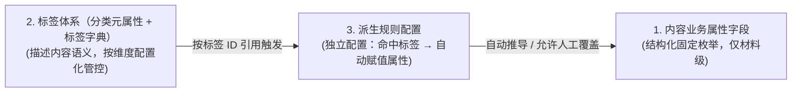
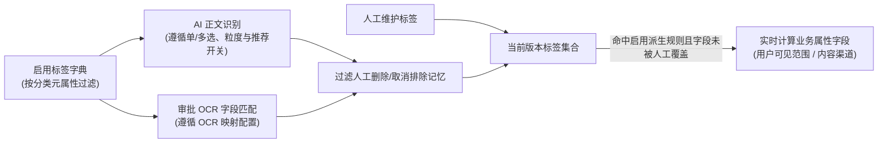

# 恒瑞 CMS 标签体系与派生规则重构：产品设计方案

## 文档元信息

| 项目 | 内容 |
| --- | --- |
| **背景与诉求** | 解除标签与写死派生规则的强耦合，理清“结构化业务属性字段”与“语义标签”的边界，支持标签分类元属性配置及可配置的派生规则 |
| **适用项目** | `hengrui-cms-prototype`（恒瑞 CMS 平台一期 / 二期演进） |
| **参考依据** | 1. 恒瑞 CMS 需求说明文档（[产品需求说明文档.md](./产品需求说明文档.md) / `恒瑞CMS需求说明文档.pdf`） 2. `恒瑞CMS平台智能标签体系_v2-1126 - 02_内容标签.csv` 3. `恒瑞CMS平台智能标签体系-H0_v20261125.xlsx` |
| **当前阶段** | **产品设计方案评审稿**（待业务口径确认后，用于修订需求文档及指导原型与研发改造） |

---

## 一、现状问题诊断

当前标签管理模块之所以在业务演进中显得混乱、补丁叠加，核心存在以下三大根因：

### 1. 概念混装：“万物皆标签”导致结构错位
- **典型表现**：`用户可见范围`、`内容渠道` 本质上是面向下游分发与终端访问控制的**结构化业务属性字段**，而不是描述文章医学/内容语义的标签。
- **引发的问题**：旧方案硬将 `用户可见范围` 塞入二级标签库，甚至以拼接字符串（如 `All三类用户`、`已注册待认证、已认证`）作为标签名，进而被迫增加了一系列特例补丁：
  - 字典写死锁定（禁止改名、停用、导出或编辑）；
  - 强制限制仅材料级可打、拦截大模型直出；
  - 自动派生却强记为 `人工` 来源，删除还要额外记入排除记忆。

### 2. 标签分类缺少“元属性（Schema）”定义
- **典型表现**：现有原型与需求中，`Tag` 模型仅包含 `id / name / parentId / enabled / external`，所有一级标签分类的行为完全同构，无法表达业务维度之间的真实差异。
- **引发的问题**：
  - `推广性质`（推广 / 非推广）天然互斥，但系统无法限制为单选；
  - `内容形式`、`目标受众` 明确要求仅人工标注，只能外挂黑盒式的“不参与 AI 匹配集合”；
  - `内容类型`、`部门` 仅适用于整份材料，却会在 PPT/PDF 单页打标时一并暴露；
  - `推广性质`、`治疗阶段/线数` 枚举封闭，却会因为 AI 识别产生大量“推荐新词”噪音。

### 3. 派生规则与具体标签值强耦合
- **典型表现**：旧需求将规则写死为“命中 8 个指定 `内容主题` → 派生 `用户可见范围` 标签”。
- **引发的问题**：在最新标签体系 `v2-1126` 中，触发源已经变为 `内容类型`（20 个枚举），派生目标也从 1 个变为 2 个（`用户可见范围` + `内容渠道`）。只要标签枚举或业务规则微调，写死逻辑即立刻失效。

---

## 二、核心架构：三层解耦模型

针对上述问题，将原本混杂在一起的“标签管理”重构为**职责清晰、松耦合的三层对象模型**：

| 层级 | 核心职责 | 消费方与主要特点 |
| --- | --- | --- |
| **第一层：内容业务属性字段** | 承载分发、渠道、终端可见性等结构化管理字段 | 枚举稳定、仅材料级、支持人工覆盖、供内容库筛选与导出包/二期发布直接消费 |
| **第二层：标签体系（分类元属性 + 标签字典）** | 维护内容与学术语义分类及词典，约束 AI 与人工行为 | 两级存储结构，通过分类元属性替代黑盒写死集合，支持动态扩展词典 |
| **第三层：派生规则配置** | 以 `WHEN → THEN` 形式连接标签与属性字段 | 独立配置与启停，按标签 ID 引用不断链，实现标签值与派生逻辑完全解耦 |

---

## 三、第一层：内容业务属性字段剥离

### 1. 判定标尺：什么是“内容属性字段”，什么是“标签”？

满足以下全部特征的项，应归属为**内容业务属性字段**，从标签字典中剥离：
1. **枚举高度稳定**：由产品/合规/运营机制决定，不随医学文献或新药上市动态造新词；
2. **仅作用于整份材料**：不存在“第 3 页仅对已认证用户可见、第 4 页对未注册用户可见”的页级差异；
3. **被下游系统按固定逻辑消费**：用于终端访问控制、渠道分发、合规校验或结构化导出顶层字段；
4. **无需 AI 推荐新词**：不进入“推荐标签”治理池。

### 2. 剥离后的业务属性字段定义

挂接在内容版本（`Version`）上的材料级“分发与可见属性”区块，采用标准多选数组存储（不再拼接 `"All三类用户"` 等字符串）：

| 属性字段 | 存储形态 | 固定枚举值 | 维护与赋值机制 |
| --- | --- | --- | --- |
| **用户可见范围** | 多选枚举数组（材料级） | `未注册`、`已注册待认证`、`已认证` | 支持由派生规则自动计算并记录来源规则；支持人工手动勾选覆盖（3 项全选时前端可简洁展示为“全部三类用户”或三项全亮） |
| **内容渠道** | 多选枚举数组（材料级，允许为空/不限） | `企业微信`（后续可扩展 `微网站`、`微信端` 等发布终端枚举） | 支持由派生规则自动计算；支持人工手动调整覆盖，天然衔接二期发布管理 |

### 3. 边界项说明：`推广性质`（推广 / 非推广）
- **现状特征**：在 `02_内容标签.csv` 中归属于“内容标签”下的二级字段，同时与审批单 OCR 识别出的 `申请类型`（推广类 / 非推广类）强相关，仅包含 `推广`、`非推广` 两个互斥值。
- **建议定位**：**保留在标签体系中**，但将其一级分类配置为 **`单选 + 仅材料级 + 系统锁定字典 + 关闭 AI 推荐新词 + 开启 AI 正文与审批 OCR 匹配`** 的受控封闭标签分类（如后续合规门禁与二期发布流程强依赖它做硬拦截，也可再评估提为内容合规属性字段，具体待评审拍板）。

---

## 四、第二层：标签分类元属性体系

### 1. 架构原则：保留两级存储，4 大域只做“分组属性”
- 继续保持现有**两级存储结构（一级标签分类 → 二级标签）**，不升级为三级树，避免内容库筛选、页级打标面板与 Excel 导入导出复杂度成倍上升。
- 新版体系中的 4 大域（`基础标签`、`内容标签`、`学术标签`、`运营标签`），作为一级分类的**所属分组（Group）**字段存在，仅用于界面分区归类与视觉折叠展示。

### 2. 一级标签分类的 6 项标准元属性

用清晰、正交的分类元属性配置，**彻底取代**原需求中黑盒化的“预置集合一（字典写死集合）”与“预置集合二（不参与 AI 匹配集合）”：

| 元属性 | 可选值 | 对系统行为的统一约束 |
| --- | --- | --- |
| **1. 所属分组** | `基础` / `内容` / `学术` / `运营` | 仅控制标签库左侧列表、内容打标面板及筛选器的分组展示顺序 |
| **2. 取值基数** | `单选` / `多选` | **同时约束 AI 与人工**：`单选` 分类下 AI 仅保留置信度最高的 1 个命中项；人工点击新标签时自动替换该分类下原有绑定；`多选` 允许绑定多个 |
| **3. 作用粒度** | `仅材料级` / `材料级 + 页级` | `仅材料级` 分类在切换到“第 N 页”页级标签视图及页级筛选器中自动隐藏，AI 也不对其执行逐页打标 |
| **4. 自动识别方式** | 多选开关： ① `AI 正文识别` ② `审批 OCR 匹配`（可选映射字段） | 两项均关闭时即代表**仅人工标注**（替代原“不参与 AI 匹配集合”）；开启审批 OCR 匹配可指定映射源（`申请部门` / `疾病领域` / `产品` / `申请类型`） |
| **5. AI 推荐新词** | `允许` / `关闭` | 开启时，AI 识别到库外候选词才生成“推荐标签”；关闭时，AI 严格收敛在当前分类已有启用枚举内，从源头减少脏推荐 |
| **6. 字典管控级别** | `系统锁定` / `可维护` | `系统锁定` 禁止改名、停用、删除、换分类或通过 Excel 修改枚举（替代原“字典写死集合”）；`可维护` 支持正常编辑与导入导出 |

*(注：二级标签保留原有的 `启用/停用` 与 `允许对外展示` 开关。)*

### 3. 全量维度配置落位总表（对齐 `v2-1126` 与 `H0_v20261125`）

共涵盖 **2 个内容业务属性字段 + 13 个一级标签分类**：

| 层级定位 | 分组 | 维度名称 | 取值基数 | 作用粒度 | AI 正文识别 | 审批 OCR 匹配 | AI 推荐新词 | 字典管控 | 枚举说明 / 备注 |
| --- | --- | --- | --- | --- | --- | --- | --- | --- | --- |
| **业务属性字段** | 分发属性 | **用户可见范围** | 多选 | 仅材料级 | 否（规则派生） | 否 | 否 | 系统固定枚举 | `未注册`、`已注册待认证`、`已认证` |
| **业务属性字段** | 分发属性 | **内容渠道** | 多选 | 仅材料级 | 否（规则派生） | 否 | 否 | 系统固定枚举 | `企业微信` 等 |
| **标签分类** | 基础 | **部门** | 单选（待定） | 仅材料级 | 关（或按需开） | 开（`申请部门`） | 关闭 | 可维护 | 18 个组织/事业部/团队枚举 |
| **标签分类** | 基础 | **品牌** | 多选 | 材料级+页级 | 开 | 开（`产品`） | 允许 | 可维护 | 药品商品品牌（随新药上市扩展） |
| **标签分类** | 内容 | **内容类型** | **单选** | 仅材料级 | 开 | 否 | 关闭 | 可维护 | **核心规则触发源**（20 个标准值） |
| **标签分类** | 内容 | **内容形式** | **单选** | 仅材料级 | **关** | 否 | 关闭 | 可维护 | 9 个形式枚举；体系要求**仅人工标注** |
| **标签分类** | 内容 | **内容主题** | 多选 | 材料级+页级 | 开 | 否 | 允许 | 可维护 | 21 个医学/药品议题枚举 |
| **标签分类** | 内容 | **推广性质** | **单选** | 仅材料级 | 开 | 开（`申请类型`） | 关闭 | **系统锁定** | 仅 `推广`、`非推广` |
| **标签分类** | 学术 | **治疗领域** | 多选 | 材料级+页级 | 开 | 开（`疾病领域`） | 关闭 | 可维护 | 17 个治疗大领域枚举 |
| **标签分类** | 学术 | **疾病/适应症** | 多选 | 材料级+页级 | 开 | 开（`疾病领域`） | 允许 | 可维护 | 具体疾病及亚型（持续扩展） |
| **标签分类** | 学术 | **研究药物** | 多选 | 材料级+页级 | 开 | 开（`产品`） | 允许 | 可维护 | 药物通用名（持续扩展） |
| **标签分类** | 学术 | **患者特征** | 多选 | 材料级+页级 | 开 | 否 | 允许 | 可维护 | 人群/分期/生物标志物等特征 |
| **标签分类** | 学术 | **治疗方式** | 多选 | 材料级+页级 | 开 | 否 | 允许 | 可维护 | 治疗方法与干预方案 |
| **标签分类** | 学术 | **治疗阶段/线数** | 多选 | 材料级+页级 | 开 | 否 | 关闭 | 可维护 | 7 个标准治疗线数/时点 |
| **标签分类** | 运营 | **目标受众** | 多选 | 仅材料级 | **关** | 否 | 关闭 | 可维护 | 9 个受众枚举；体系要求**仅人工标注** |

---

## 五、第三层：可配置派生规则引擎

将派生逻辑抽离为独立可配置的 `WHEN → THEN` 规则引擎，规则只引用**标签 ID** 与 **目标属性字段标识**，彻底与标签名称解耦。

### 1. 规则数据模型

| 规则组成 | 配置项 | 说明 |
| --- | --- | --- |
| **基础信息** | 规则名称、启用状态、说明 | 支持随时启停、编辑或删除，不修改系统代码 |
| **触发条件（WHEN）** | 条件组（一期默认支持 1 个分类条件，数据结构预留多条件 `AND` 数组）： • 触发分类 ID（如 `内容类型`） • 触发标签 ID 集合（多选，组内为 **OR** 关系） • 触发作用域（`仅材料级` / `材料级 ∪ 全部页级`，若触发分类为 `仅材料级` 则自动锁定为仅材料级） | 命中集合中任意一个启用标签即满足条件；按 `tagId` 引用，标签改名不影响规则有效性 |
| **派生动作（THEN）** | 目标字段赋值列表（可配 1~N 个目标属性字段）： • `用户可见范围`：勾选赋值的枚举数组 • `内容渠道`：勾选赋值的枚举数组 | 一条规则可同时触发多个目标属性字段（例如同时设定可见范围和内容渠道） |

> **防成环原则**：一期派生目标**仅限内容业务属性字段**，不派生回标签字典，天然杜绝规则循环触发；若未来扩展支持“标签派生标签”，必须禁止目标分类再作为任何规则的触发源。

### 2. 对齐 `v2-1126 - 02_内容标签.csv` 的初始化规则示例

基于当前业务表格中的 20 个 `内容类型` 映射关系，仅需配置 3 条规则即可完整覆盖：

| 规则名称 | 触发条件（WHEN：`内容类型` 命中任一） | 派生结果（THEN） |
| --- | --- | --- |
| **R1：公开科普与指南类可见范围** | `指南共识`、`政策解读`、`文献解读`、`领域发展`、`患者故事`、`项目报道`、`大咖论道`、`疾病科普`、`临床试验招募`、`患者教育`（共 10 项） | `用户可见范围` = `[未注册, 已注册待认证, 已认证]` |
| **R2：专业医学与产品信息可见范围** | `用药说明`、`会议邀请`、`会议报道`、`产品信息`、`病例解读`（共 5 项） | `用户可见范围` = `[已注册待认证, 已认证]` |
| **R3：企微专属专业材料分发规则** | `FAQ`、`产品DA`、`科室会幻灯`、`学术会议幻灯`、`产品准入`（共 5 项） | `用户可见范围` = `[已注册待认证, 已认证]` **且** `内容渠道` = `[企业微信]` |

### 3. 四项核心运行机制（产品底线规则）

#### （1）多条规则同时命中时的合并策略
当未来配置多条不同维度触发的规则且同时命中同一份内容时，按目标字段的业务语义定死合并策略，避免不可预测的覆盖：
- **`用户可见范围`（安全合规优先 → 取交集）**：例如规则 A 推导 `[未注册, 已注册待认证, 已认证]`，规则 B（如按推广性质触发）推导 `[已注册待认证, 已认证]`，最终取交集 `[已注册待认证, 已认证]`，防止敏感/专业内容意外暴露给未注册用户。
- **`内容渠道`（分发触达优先 → 取并集）**：多条规则命中的渠道合并生效。
- **未命中任何规则时**：保持字段为空（不乱赋默认值，需发布或入库校验时按业务规则提示）。

#### （2）自动派生 vs 人工覆盖锁定（取代“排除记忆”）
每个可派生属性字段均维护独立的来源状态：`自动派生（记录命中规则名称）` 或 `人工已覆盖`：
- **处于 `自动派生` 状态时**：每次标签发生变化（AI 异步打标完成、人工增删标签、批量标签同步），系统均**实时全量重算**该字段。如果移除了原触发标签，字段值同步更新为新规则结果或清空，不再出现旧数据粘滞。
- **人工手动修改该字段时**：字段状态立即切换为 `人工已覆盖`。此后无论标签如何增删、重跑同步，系统**严格保留人工结果，不再自动覆写**。
- **一键恢复自动计算**：字段旁展示「恢复规则自动计算」入口；用户点击后解除覆盖锁定，立即按当前标签集重新计算并切回 `自动派生` 状态。

#### （3）规则变更对存量内容的影响边界
- **默认不静默改写存量正式内容**：新增、编辑或启停规则后，**仅对后续新上传暂存、待归档处理中、或人工主动编辑标签的内容实时生效**，不直接篡改已归档历史快照或线上现行版本（保障医药合规审计可追溯）。
- **存量批量刷新通道**：如需让新规则生效到存量正式内容，需通过模块六「同步最新标签到文件」发起批量任务（同步弹窗可提供“同时重算未人工覆盖的派生属性”选项），经待归档确认工作台核对后生成新版本。

#### （4）标签维护与规则的引用保护
- **标签改名**：因规则按 `tagId` 引用，标签改名后规则自动展示新名称，不失效。
- **停用标签或分类**：停用前若被已启用规则引用，弹窗提示“当前有 N 条启用规则正在使用该标签”；停用后规则详情中对应标签置灰标记 `已停用`，不再触发匹配，但不阻塞保存或引发运行时报错。
- **执行流水线（全链路去补丁化）**：

*(大模型完全不感知 `用户可见范围` 与 `内容渠道`，彻底消除“拦截大模型直出”的冗余逻辑。)*

---

## 六、页面交互与下游联动规划

### 1. 模块六「标签管理」页面重组（3 页签）
- **Tab 1：标签库**
  - 左侧一级分类按 `基础 / 内容 / 学术 / 运营` 四个分组折叠排列；每行用轻量徽标直观显示分类元属性（如 `单选`、`仅材料级`、`仅人工`、`已锁定`）。
  - 新增 / 编辑一级分类弹窗：除名称、启停、对外展示外，支持配置 6 项标准元属性。
  - 右侧二级标签卡片：仅维护标签名、启停、对外展示；所属分类为 `系统锁定` 时，禁用编辑/停用并展示只读提示。
  - Excel 导入导出：保留双表结构，在 `标签分类` 表补充元属性列（或规定分类元属性仅界面维护，Excel 专注于批量维护 `可维护` 分类下的二级标签词典，减少填表出错）。
- **Tab 2：派生规则（新增）**
  - 列表字段：`规则名称`、`触发条件（分类 + 标签组）`、`派生结果（可见范围 / 内容渠道）`、`启停状态`、`最近更新时间`、`操作（编辑/启停/删除）`。
  - 支持规则内多选批量勾选触发标签（如一个表单弹窗即可配完 10 个 `内容类型` 到三类用户的映射）。
- **Tab 3：推荐标签**
  - 仅接收开启了 `允许 AI 推荐新词` 的分类产生的未入库候选词；原有按来源采纳、取消与恢复机制保持不变。

### 2. 「待归档确认页」与「正式内容详情页」重构
- **独立「分发与可见属性」区块**：置于右侧打标/信息工作区顶部（与材料级内容绑定），集中展示与编辑：
  - `用户可见范围`：`[未注册] [已注册待认证] [已认证]` 多选框；
  - `内容渠道`：`[企业微信]` 等多选标签/复选框；
  - 状态提示行：自动派生时显示 `自动派生自：{规则名称}`；人工调整后显示 `已人工覆盖` + `恢复自动计算` 按钮。
- **下方「打标结果」按元属性自适应交互**：
  - 按 4 大分组归类展示；
  - `单选` 分类（如 `内容类型`、`内容形式`、`推广性质`）支持单选切换替换；
  - 当切换到 `第 N 页` 页级标签时，面板与「添加标签」弹窗自动隐藏 `仅材料级` 分类，大幅降低页面视觉干扰。

### 3. 下游筛选、导出与审计联动
- **内容库列表筛选**：将 `用户可见范围`、`内容渠道` 提升为独立筛选项，脱离原二级标签筛选面板。
- **结构化资产包导出（`metadata.json`）**：将 `visibleAudience`（字符串数组）与 `channels`（字符串数组）作为顶层标准字段输出，不再混入 `tags` 数组，降低下游微网站/企微端解析复杂度。
- **操作审计（模块十）**：在 `标签管理` 模块下新增 `新增派生规则`、`编辑派生规则`、`启停派生规则`、`删除派生规则` 标准操作记录；内容侧手动覆盖或恢复派生属性记入 `内容库 / 修改内容信息` 或 `修改内容标签`；后台规则自动重算不产生人工操作审计。

---

## 七、一期落地边界与待确认决策清单

### 1. 一期克制边界（防止过度设计）
- **一期纳入**：业务属性字段剥离、分类 6 项元属性体系、独立 `WHEN → THEN` 派生规则配置、自动重算与人工覆盖锁定、内容库筛选与导出结构升级。
- **一期不做**：不做三级标签树（4 大域仅作展示分组）；不开放动态自定义新增“业务属性字段”（先内置 `用户可见范围`、`内容渠道`）；不做复杂脚本/嵌套括号表达式引擎；规则保存不静默篡改历史已归档版本。

### 2. 待产品与业务拍板的 4 个关键口径

| 序号 | 决策项 | 选项说明与建议 | 最终拍板结论（待填写） |
| --- | --- | --- | --- |
| **1** | **`推广性质`（推广 / 非推广）定位** | • **方案 A（推荐）**：保留为标签分类（`内容` 分组、`单选 + 仅材料级 + 系统锁定 + 支持 AI 与 OCR 匹配 + 禁推荐新词`） • **方案 B**：与可见范围一样提为内容业务属性字段 | 待确认 |
| **2** | **`内容类型` 是否严格单选** | • **方案 A（推荐）**：严格`单选`（对齐 CSV“按主要内容属性判断”口径，同时从源头减少规则冲突） • **方案 B**：允许`多选`（需启用多规则交/并集合并机制） | 待确认 |
| **3** | **多规则冲突合并策略** | • `用户可见范围`：多规则命中时取**交集**（合规安全优先，范围从严） • `内容渠道`：多规则命中时取**并集**（渠道触达合并） | 待确认 |
| **4** | **`部门` 分类单选还是多选** | • `单选`：每份材料仅归属 1 个主责部门 • `多选`：支持跨事业部联合材料绑定多个部门 | 待确认 |
